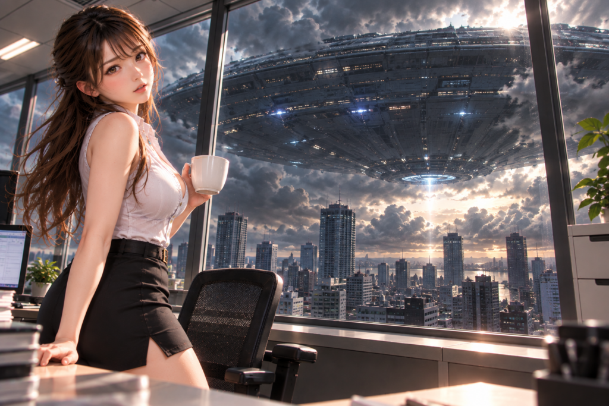

## 第一話「空が消えた日」

「コーヒー、いかがですか？」

紗月は、淹れたてのコーヒーをデスクに置いた。

窓から差し込む午後の日差しが、白いカップを明るく照らしている。

いつものオフィス。いつもの午後。

紗月は白いノースリーブのシャツに黒いタイトスカートという、いつもの仕事着だった。

「さて、と」

自分のカップにもコーヒーを注ぎ、ひと息つく。

仕事はまだ残っている。

けれど、こうして少し休む時間も嫌いではない。

このオフィスには、個性的な仲間たちがいた。

別の部署にいるティルスは、少し不思議な女性だった。

長い耳を持ち、古い言葉で詠唱することができる。

本人は当たり前のように魔法を使っているが、紗月にはその仕組みがさっぱりわからない。

そして、ルナ。

オレンジ色のポニーテールが印象的な、発明好きの女性だ。

機械を分解しては組み立て、何かを思いつくと時間を忘れて研究に没頭する。

この二人とは、仕事でも何かと顔を合わせる。

不思議な組み合わせではあるけれど、紗月は二人と過ごす時間が好きだった。

そのときだった。

「……あれ？」

紗月は窓の外を見た。

さっきまで明るかった空が、少し暗くなっている。

雲でも出てきたのだろうか。

そう思って窓に近づいた。

しかし、違った。

空が、消えていく。

いや、正確には、何かが空を覆っている。

「……何、あれ？」

遠くのビルの向こうに、巨大な黒い物体が見えた。

その輪郭は、ゆっくりと広がっているように見える。

いや、広がっているのではない。

あまりにも巨大なものが、こちらへ近づいているのだ。

円盤。

そう呼ぶしかない形だった。

しかし、映画で見たような空飛ぶ円盤とは、まるで大きさが違う。

都市全体を覆ってしまいそうな巨大な船体。

その表面には、無数の線や幾何学的な模様が走っていた。

紗月は窓に手をついた。

「……宇宙船？」

信じられなかった。

あんな巨大なものが、どうして空に浮かんでいられるのだろう。

しかも、音がしない。

エンジン音も、風の音もない。

ただ、そこに存在している。

突然、オフィスのあちこちで声が上がった。

「何だ、あれ！」

「ニュース見て！」

「本物なのか！？」

スマートフォンを取り出す人。

窓際に集まる人。

電話をかけ始める人。

紗月もニュースを確認した。

画面には、各地の空に現れた巨大な物体の映像が映っている。

どうやら、ここだけではないらしい。

そのとき、廊下から慌ただしい足音が聞こえた。

「紗月！」

勢いよくドアが開いた。

ティルスだった。

「見た！？ 外！」

「うん……見てる」

ティルスは窓の外を見上げた。

「……大きい」

しばらく、二人とも言葉を失った。

やがてティルスが小さくつぶやいた。

「ねえ、紗月。あれ、誰が乗ってるんだろう？」

「……わからない」

ティルスは窓に向かって手を伸ばした。

指先に、淡い青い光がともる。

小さな魔法陣が現れた。

何かを調べようとしているのだろう。

しかし、数秒後。

光は静かに消えてしまった。

「……ダメ」

「どうしたの？」

「何もわからない。魔法が届かないというより……何を感じ取ればいいのかさえ、わからないの」

ティルスは困ったように首をかしげた。

「ねえ、ルナなら何かわかるんじゃない？」

紗月はうなずいた。

「そうね。連絡してみましょう」

スマートフォンを取り出した、そのとき。

再び空が暗くなった。

巨大な円盤の底面に、青白い光が走っている。

「……ティルス」

「うん」

二人は窓の外を見つめた。

円盤の中心に、ゆっくりと光の輪が現れた。

それは規則正しく明滅しながら、少しずつ輝きを増していく。

紗月は、まだ温かいコーヒーカップを見た。

ほんの数分前まで、ごく普通の午後だった。

何も変わらないはずの一日だった。

けれど今、目の前には、人類が一度も見たことのないものが浮かんでいる。

「……何が始まるんだろう」

紗月の問いに、ティルスは答えられなかった。

巨大な円盤は、何も語らない。

ただ静かに、都市の上空に浮かんでいた。

そして、その船内では。

地球上のある一点を示す光が、静かに点滅していた。

まだ誰も知らない。

その光が、ひとりの女性を指し示していることを。

紗月。

後に「がでがる」と呼ばれる守護者たち。

その源流となる、最初の一滴だった。

---

第一話・了
