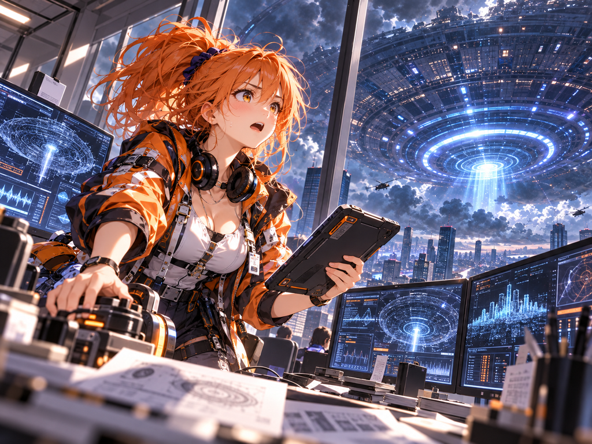
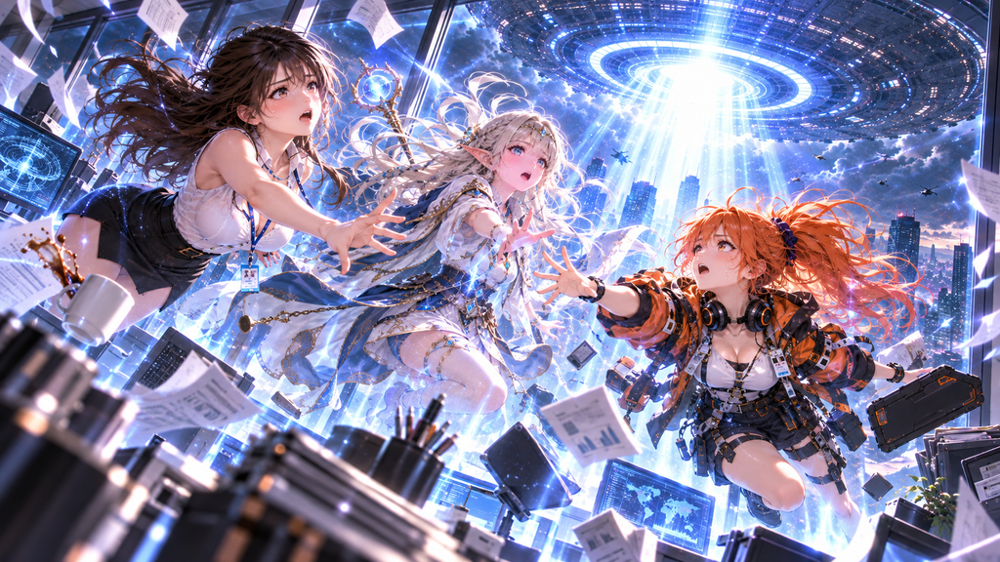
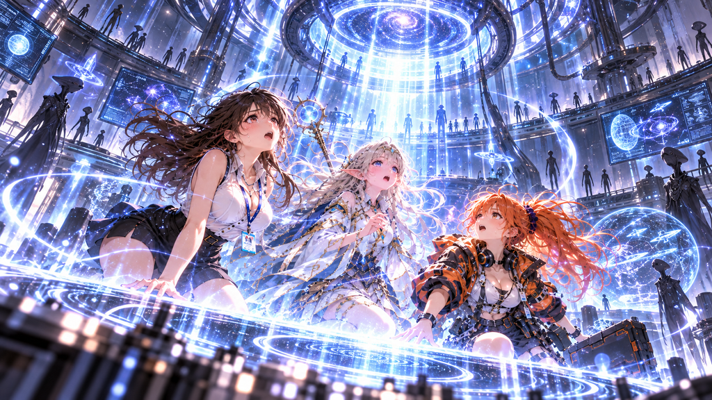

## 第二話「光の向こうへ」

「ルナ、出て……！」

紗月はスマートフォンを耳に当てた。

窓の外では、巨大な円盤が都市の上空に静止している。

相変わらず音はしない。

ただ、円盤の底面にある青白い光だけが、ゆっくりと明滅していた。

「……もしもし？」

ようやく電話がつながった。

「ルナ！ 大変なの！」

『うん、わかってる！ 今、そっちに向かってる！』

電話の向こうから、慌ただしい物音が聞こえた。

『それより紗月、窓から離れないで！ あれ、何か変なの！』

「変って？」

『説明できない！ とにかく待ってて！』

電話が切れた。

紗月とティルスは顔を見合わせた。

「……ルナも、わからないみたいね」

「うん。でも、何か調べてるんだと思う」

その数分後。

「紗月！ ティルス！」

オフィスのドアが勢いよく開いた。

オレンジ色のポニーテールを揺らしながら、ルナが飛び込んできた。

片手にはタブレット、もう片方には見慣れない小型装置を抱えている。

「ちょっと、そこ空けて！」

ルナはデスクに装置を置き、素早く操作を始めた。

画面に複雑なグラフが現れる。

「これ、さっきから観測してるんだけど……」

「何かわかった？」

紗月が尋ねた。

ルナは首を横に振った。

「全然」

ティルス「えっ？」

「熱反応が変なの。あれだけ大きな物体なのに、周囲の空気にほとんど変化がない」

ルナは別の画面を開いた。

「重力の影響も、予想と合わない。推進装置らしいものも見当たらない」

紗月「でも、実際に浮いてるわよね？」

「そう！ そこが問題なの！」

ルナは頭を抱えた。

「私の知ってる物理法則だけじゃ、説明できない！」

ティルスがおずおずと手を上げた。

「……魔法、という可能性は？」

ルナはティルスを見た。

「それも考えた。でも、あなたの詠唱でも調べられなかったんでしょ？」

「うん。何も感じ取れなかった」

「だったら、ますますわからない」

三人は窓の外を見上げた。

巨大な円盤。

その表面には、規則的とも不規則ともつかない光の模様が浮かんでいる。

「ねえ……」

ティルスが小さくつぶやいた。

「あの中に、誰かいるのかな？」

紗月「……いるんじゃないかしら」

ルナ「どうしてそう思うの？」

「だって、あんなものが自然にできるとは思えないもの」

ルナは少し考えてから、うなずいた。

「確かにね」

そのときだった。

ピッ。

ルナの装置が短い電子音を発した。

「あれ？」

画面のグラフが突然変化した。

「……ちょっと待って」

ルナの指が止まった。

「どうしたの？」

「円盤の中心から、何かが出てる」

紗月とティルスが窓に近づいた。

円盤の底面。

青白い光の輪が、ゆっくりと回転を始めていた。

そして。

一本の細い光が、地上に向かって伸びた。

「……光？」

最初は、遠くの街を照らしているように見えた。

しかし、その光は次第にこちらへ近づいてくる。

ルナが画面を見つめながら叫んだ。

「違う！ 光が移動してるんじゃない！」

「えっ？」

「照射する場所を探してるみたいなの！」

青白い光が、ビルからビルへと移っていく。

まるで何かを確認しているかのように。

そして、突然止まった。

紗月「……あれ？」

ティルス「……こっち、見てない？」

ルナは装置を持ち上げた。

画面には、赤い文字が点滅している。

測定不能。

「……まずい」

「何が？」

ルナが顔を上げた。

「こっちに来る！」

その瞬間。

窓の外が真っ白になった。

眩しいほどの青白い光が、オフィス全体を包み込んだ。

「きゃっ！」

紗月は思わず目を閉じた。

しかし、不思議なことに、熱くも痛くもなかった。

ただ、身体がふわりと軽くなる。

「……え？」

足元を見る。

床が遠ざかっていた。

「ちょ、ちょっと！ 浮いてる！？」

ルナが叫んだ。

ティルスも、床から離れていた。

「紗月！ ルナ！」

三人の身体が、ゆっくりと宙に浮かんでいく。

デスクの上の書類が舞い上がる。

ペンが回転し、タブレットが宙を漂う。

そして、紗月が飲みかけていたコーヒーカップも浮かび上がった。

「……私のコーヒー！」

「紗月！ 今それどころじゃないって！」

ルナの叫び声が響いた。

ティルスは必死に詠唱を始めた。

しかし、魔法陣は現れない。

「ダメ！ 何もできない！」

三人は互いに手を伸ばした。

紗月の指先が、ティルスの手に触れる。

その反対側から、ルナが飛びつくように手を伸ばした。

「離れないで！」

紗月が叫んだ。

三人は、しっかりと手を握り合った。

次の瞬間。

視界が青白い光で埋め尽くされた。

身体が、ものすごい速さで引き上げられていく。

下を見ると、オフィスが小さくなっていた。

ビルが小さくなり、街が遠ざかる。

そして頭上には、巨大な円盤の底面が迫っていた。

「……うそ」

紗月は声を失った。

円盤の中心に、巨大な円形の開口部が見える。

その奥には、地上からは想像もできなかった複雑な構造物が広がっていた。

無数の光。

幾重にも重なる金属のような壁。

そして、ゆっくりと回転する巨大な輪。

ルナが叫んだ。

「紗月！ 目を閉じて！」

しかし、もう遅かった。

眩しい光が三人を包み込む。

紗月は最後の力で、二人の手を握りしめた。

「……絶対、離れないでね」

誰かが返事をしたような気がした。

けれど、その声は聞き取れなかった。

そして。

何も見えなくなった。

何も聞こえなくなった。

三人の意識は、そこで途切れた。

---

巨大な円盤は、依然として都市の上空に浮かんでいた。

何事もなかったかのように。

光は消え、街には再び薄暗い午後が戻っていた。

しかし、ひとつだけ確かなことがあった。

紗月、ティルス、ルナ。

三人の姿が、オフィスから消えていた。

そして、巨大宇宙船の内部。

誰もいないように見える白い部屋で、三つの小さな光が順番に点灯した。

まだ、三人は知らない。

この出来事が、後に「がでがる」と呼ばれる物語の始まりになることを。

第二話・了

次回「目覚めた場所」
